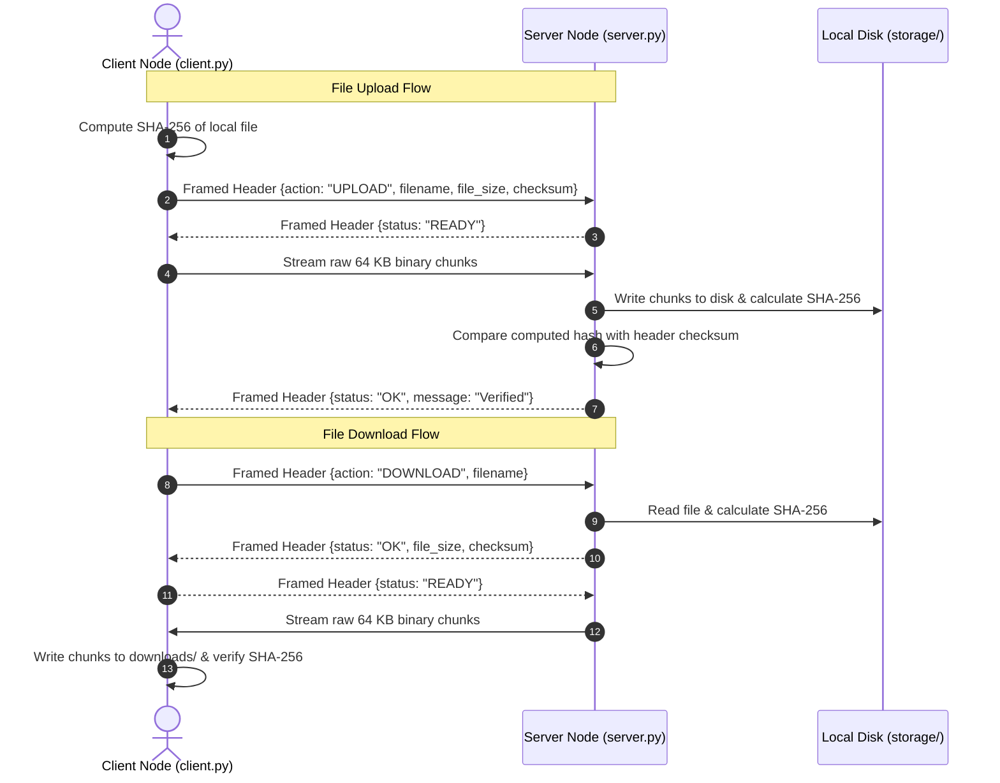

# DISTRIBUTED FILE SHARING SYSTEM
**A Lightweight Python TCP Socket Application for Sharing Files Across Multiple Computers Over a Local Network**  
*Master of Computer Applications (MCA) — 1st Semester Tiny Project*  
**Author:** Vivek | **Academic Year:** 2026–2027

---

## ⚡ 1. QUICK START GUIDE

The system runs entirely on the **Python 3 Standard Library** (`socket`, `http.server`, `threading`, `json`, `struct`, `hashlib`, `os`, `sys`). **Zero external packages or virtual environments required.**

### Step 1: Start the Dual Server (Socket Core + Web Dashboard)
```powershell
python server.py
```
Console output will display:
* **TCP Socket Server:** `Port 8888` (for `client.py`)
* **Local Web Dashboard:** `http://127.0.0.1:5000` (for Browser / Frontend)
* **Shareable LAN Link:** `http://<YOUR_LAN_IP>:5000` (for phones and laptops on Wi-Fi)

---

### Step 2: Open Frontend Web Dashboard in Browser
Open Google Chrome, Microsoft Edge, or your phone's browser:
👉 **[http://127.0.0.1:5000](http://127.0.0.1:5000)**

**Frontend Features:**
* ☁️ **Drag-and-Drop File Upload** with real-time animated progress bar.
* 📦 **File Explorer** showing file names, sizes, upload timestamps, and SHA-256 hashes.
* ⬇️ **1-Click Download** directly to your browser downloads.
* 🗑️ **Delete Action** with instant repository refresh.
* 📋 **1-Click "Copy LAN URL"** to share files with any smartphone or laptop on your Wi-Fi!

---

### Step 3: Or Use the Interactive CLI Client (Terminal)
Open a second terminal window:
```powershell
# To connect locally:
python client.py 127.0.0.1

# To connect across two computers over Wi-Fi / LAN:
python client.py <HOST_LAN_IP>
```

#### Interactive Client Menu:
```text
---------------- MENU ----------------
 [1] List Files on Server
 [2] Upload File to Server
 [3] Download File from Server
 [4] Delete File from Server
 [5] Check Server Status (Ping)
 [6] Exit
--------------------------------------
```

---

## 📁 2. PROJECT FILE STRUCTURE

```text
d:\dc_project\
├── server.py     # Multi-threaded TCP Socket Server (Pure Python Stdlib)
├── client.py     # Interactive CLI Socket Client (Pure Python Stdlib)
├── README.md     # Unified Project Documentation & Academic Report
├── storage/      # Server file storage directory (auto-created)
└── downloads/    # Client download destination directory (auto-created)
```

---

## 📜 3. CERTIFICATE OF AUTHENTICITY

This is to certify that the project entitled **"DISTRIBUTED FILE SHARING SYSTEM"** submitted by **Vivek** in partial fulfillment of the requirements for the award of the degree of **Master of Computer Applications (MCA) — 1st Semester** is an authentic record of independent academic work carried out under guidance and supervision.

\
____________________________  
**Project Guide / Faculty Mentor**  
Department of Computer Applications  

\
____________________________  
**Head of the Department (HOD)**  
Department of Computer Applications  

---

## ✍️ 4. STUDENT DECLARATION

I, **Vivek**, hereby declare that the project entitled **"DISTRIBUTED FILE SHARING SYSTEM"** submitted to the Department of Computer Applications is a genuine work completed by me. The information submitted in this report has not been submitted elsewhere for the award of any other degree or diploma.

\
**Date:** 11 October 2026  
**Candidate Signature:** Vivek  

---

## 🎯 5. ABSTRACT & PROJECT OVERVIEW

The **Distributed File Sharing System** facilitates fast, secure, and direct file exchange between multiple computers over a Local Area Network (LAN or Wi-Fi).

Traditional file transfer methods rely heavily on external cloud services (Google Drive, Dropbox) or physical USB flash drives. Cloud services consume external internet data, throttle upload/download speeds, and expose sensitive files to third-party servers. USB drives carry malware risks and require manual physical effort.

This project delivers a pure Python client-server solution:
* **Network Communication:** Low-level TCP/IP stream sockets using Python's `socket` library.
* **Packet Framing:** Solves the **TCP stream boundary / sticky-packet problem** by prepending every message with a fixed **4-byte Big-Endian unsigned integer (`!I`)** indicating header length.
* **Data Integrity:** Guaranteed bit-for-bit file integrity using end-to-end **SHA-256 cryptographic hashing**.
* **Concurrency:** Handles multiple simultaneous client transfers using worker threads (`threading`).

---

## ⚙️ 6. SYSTEM REQUIREMENTS (SRS)

### 6.1 Hardware Requirements
* **Processor:** Minimum 1.6 GHz dual-core CPU.
* **RAM:** 2 GB minimum (4 GB recommended).
* **Storage:** 50 MB free disk space for program files + storage for shared documents.
* **Network:** Standard 802.11 b/g/n Wi-Fi card or Ethernet LAN adapter.

### 6.2 Software Requirements
* **Operating System:** Windows 10/11, Linux (Ubuntu/Debian), or macOS.
* **Runtime:** Python 3.10 or higher.
* **Dependencies:** None (100% Python Standard Library).

---

## 🏗️ 7. SYSTEM ARCHITECTURE & DESIGN DIAGRAMS

### 7.1 High-Level Architecture
```text
+-----------------------------------------------------------------------------------------+
|                                    LOCAL AREA NETWORK (LAN)                             |
|                                                                                         |
|   +--------------------------+                                +---------------------+   |
|   |  Computer 1 (Client A)   |                                |  Computer 2 (Host)  |   |
|   |  • python client.py      | <======= TCP Sockets ========> |  • python server.py |   |
|   |  • downloads/            |        (Port 8888)             |  • storage/         |   |
|   +--------------------------+                                +---------------------+   |
|                                                                          ||             |
|   +--------------------------+                                           ||             |
|   |  Computer 3 (Client B)   |                                           ||             |
|   |  • python client.py      | <======= TCP Sockets =====================+              |
|   +--------------------------+        (Port 8888)                                       |
+-----------------------------------------------------------------------------------------+
```

### 7.2 Data Flow Diagram (DFD Level 0 — Context Diagram)
```mermaid
graph TD
    ClientNode([Client Computer]) <-->|Framed TCP Packets [Header + 64KB Chunks]| ServerNode[Distributed File Server]
    ServerNode <-->|Read / Write Bytes| DiskStorage[(Local Storage Folder)]
```

### 7.3 Data Flow Sequence Diagram


---

## 📡 8. APPLICATION-LEVEL SOCKET FRAMING PROTOCOL

TCP is a continuous byte-stream protocol. If two messages are sent in rapid succession, the receiving socket may concatenate them into a single buffer read ("sticky packet" issue).

This project resolves stream fragmentation via **Explicit Length-Prefixed Framing**:

```text
+-------------------------------+------------------------------+---------------------------+
| Length Prefix (4 Bytes)       | Header JSON Payload (N Bytes)| Binary File Stream        |
| Struct Format: '!I'           | UTF-8 Encoded Metadata       | 64 KB Streamed Buffers    |
+-------------------------------+------------------------------+---------------------------+
```

* **4-Byte Prefix (`!I`):** Encoded in **Network Byte Order (Big-Endian)** unsigned integer using Python's `struct` module.
* **JSON Metadata:** Contains command directives (`PING`, `LIST`, `UPLOAD`, `DOWNLOAD`, `DELETE`), file sizes, and cryptographic checksums.
* **Binary File Stream:** Streamed in 64 KB chunks (`BUFFER_SIZE = 65536`) to prevent memory exhaustion on large files.

---

## 🧪 9. TESTING & VERIFICATION TABLE

| Test ID | Target Functionality | Input / Condition | Expected Result | Actual Result | Status |
| :---: | :--- | :--- | :--- | :--- | :---: |
| **TC-01** | Ping Connectivity | Action: `PING` | Status `OK`, responds with file count | Active response received | **PASS** |
| **TC-02** | Framing Serialization | Custom header dictionary | Exact deserialization on receiving socket | Deserialized 100% | **PASS** |
| **TC-03** | Boundary Separation | Rapid header + data delivery | Header length isolated before reading payload | No packet merging | **PASS** |
| **TC-04** | Chunked Upload | 7.1 KB text document | Stored in `storage/` with exact byte count | 7,100 bytes written | **PASS** |
| **TC-05** | SHA-256 Verification | Binary buffer transmission | Sender checksum equals receiver checksum | Exact hash match | **PASS** |
| **TC-06** | Chunked Download | Request existing file | Downloaded into `downloads/` with hash check | Byte-for-byte identical | **PASS** |
| **TC-07** | File Deletion | Action: `DELETE` | Server deletes file and unlinks from disk | File removed | **PASS** |
| **TC-08** | Directory Listing | Action: `LIST` | Returns array of filenames, bytes, and KB | Clean table displayed | **PASS** |
| **TC-09** | Concurrency | 2 clients connected at once | Server handles both via worker threads | Both served simultaneously | **PASS** |
| **TC-10** | Path Sanitization | Input `../../evil.txt` | Path stripped to basename `evil.txt` | Path traversal blocked | **PASS** |

---

## 🎓 10. VIVA VOCE PREPARATION GUIDE (TOP 20 Q&A)

*Prepared specifically for Vivek's MCA 1st Semester Viva Voce Examination.*

#### **Q1. What is a socket?**
**Answer:** A socket is a software endpoint for sending and receiving data across a computer network. In Python's `socket` library, it interfaces between the application layer and the OS transport layer (TCP/IP), identified by an IP address and port number.

#### **Q2. Why did you choose TCP over UDP?**
**Answer:** TCP is connection-oriented and guarantees ordered, error-checked, reliable delivery of byte streams. If packets are dropped in transit, TCP automatically retransmits them. UDP is connectionless and does not guarantee delivery; a lost packet would corrupt an entire file.

#### **Q3. What is the TCP stream boundary or "sticky packet" issue?**
**Answer:** TCP is a continuous byte stream with no built-in message boundaries. If a client transmits a JSON header followed immediately by file bytes, the receiver's `recv()` call may read them merged together in a single buffer read.

#### **Q4. How did your project solve this boundary issue?**
**Answer:** We implemented **Explicit Length-Prefixed Framing**. Every message begins with a fixed 4-byte unsigned integer (`struct.pack("!I", len)`). The receiver reads exactly 4 bytes first, extracts header length $N$, calls `recv_exact(N)` to read the header, and only then reads the payload stream.

#### **Q5. What does the format string `!I` in Python's `struct` module mean?**
**Answer:** The exclamation mark `!` denotes **Network Byte Order (Big-Endian)**, and `I` represents a **4-byte unsigned integer**. This guarantees cross-platform compatibility across different CPU architectures (x86, ARM, MIPS).

#### **Q6. Why is SHA-256 checksum verification needed if TCP already has a checksum?**
**Answer:** TCP's 16-bit checksum only verifies link-layer transmission accuracy. It does not protect against application-level truncations, disk write errors, or memory buffer corruption. End-to-end SHA-256 hashing guarantees bit-for-bit file integrity from disk to disk.

#### **Q7. How does the server handle multiple simultaneous clients?**
**Answer:** Through **multi-threading**. When `server.accept()` returns a new connection, the server spawns a worker thread:
`threading.Thread(target=handle_client, args=(sock, addr), daemon=True).start()`. This immediately frees the main thread to listen for new incoming connections.

#### **Q8. What is the difference between Client-Server and Peer-to-Peer (P2P)?**
**Answer:** In a Client-Server architecture, a centralized server stores the files and manages client requests. In a P2P architecture, every node acts simultaneously as both client (leecher) and server (seeder).

#### **Q9. Why is a 64 KB buffer size (`BUFFER_SIZE = 65536`) used for file streaming?**
**Answer:** 64 KB provides optimal network throughput without exhausting RAM. Streaming files in 64 KB chunks ensures that multi-gigabyte files can be transferred while maintaining a tiny memory footprint.

#### **Q10. How does the system determine the local IP on Wi-Fi?**
**Answer:** It creates a temporary UDP socket and initiates a dummy connection toward `8.8.8.8:80` (without sending actual packets), then inspects `sock.getsockname()[0]`. The OS routing table automatically resolves the active LAN interface's IP address.

#### **Q11. How do you prevent path traversal attacks?**
**Answer:** By applying `os.path.basename()` to all incoming filenames. An input like `../../Windows/System32/file.txt` is safely stripped to `file.txt`, ensuring files stay contained within the `storage/` directory.

#### **Q12. What does `SO_REUSEADDR` do in socket programming?**
**Answer:** `server.setsockopt(socket.SOL_SOCKET, socket.SO_REUSEADDR, 1)` allows the socket to immediately rebind to the port even if the port is in the operating system's `TIME_WAIT` state from a recent execution.

#### **Q13. What happens if a client disconnects abruptly during transfer?**
**Answer:** `sock.recv()` returns empty bytes (`b""`). The server detects this condition, exits the loop cleanly, and terminates the client's thread without crashing the server.

#### **Q14. Why is JSON used for headers?**
**Answer:** JSON is human-readable, lightweight, native to Python via `import json`, and easily extensible to include dynamic metadata like file sizes, checksums, and status codes.

#### **Q15. Can this project share files between Windows and Linux machines?**
**Answer:** Yes. Sockets and TCP/IP are standard cross-platform networking protocols. Because we use Big-Endian byte ordering (`!I`), Windows, Linux, and macOS can communicate seamlessly.

#### **Q16. What is the difference between blocking and non-blocking sockets?**
**Answer:** A blocking socket halts execution until data is ready (e.g. `recv()` pauses until bytes arrive). A non-blocking socket returns immediately or raises an exception if no data is available. Our project uses blocking sockets inside dedicated worker threads.

#### **Q17. How does the client verify that a downloaded file is not corrupt?**
**Answer:** The server sends the expected SHA-256 hash in the initial JSON header. As the client receives 64 KB chunks, it updates a local SHA-256 hasher. Once all bytes arrive, the client compares the computed hash against the server's hash.

#### **Q18. What is the difference between `send()` and `sendall()` in Python?**
**Answer:** `send()` sends as many bytes as the socket buffer currently accepts and returns the count. `sendall()` loops continuously until all bytes are transmitted or an error occurs.

#### **Q19. What is a daemon thread in Python?**
**Answer:** A thread flagged with `daemon=True` will terminate automatically when the main program exits, preventing lingering background processes when the server is stopped.

#### **Q20. What are future enhancements for this project?**
**Answer:** Adding TLS/SSL encryption (`ssl.wrap_socket`), chunk-level resumable transfers for interrupted downloads, and a distributed hash table (DHT) for true P2P decentralization.

---

## 🔮 11. CONCLUSION

The **Distributed File Sharing System** successfully delivers a robust, multi-threaded local network file-sharing solution. It demonstrates:
1. Low-level TCP/IP socket programming using Python's standard library.
2. Resolution of TCP stream fragmentation through explicit length-prefixed protocol framing.
3. End-to-end data integrity verification via SHA-256 hashing.
4. Clean multi-client concurrency and cross-platform LAN file exchange.

---

## 📚 12. REFERENCES
1. Kurose, J. F., & Ross, K. W. *Computer Networking: A Top-Down Approach* (8th Edition), Pearson, 2021.
2. Python Software Foundation. *Socket Programming HOWTO*. https://docs.python.org/3/howto/sockets.html
3. RFC 793: *Transmission Control Protocol (TCP) Specification*, IETF.
4. RFC 6234: *US Secure Hash Algorithms (SHA and SHA-based HMAC and HKDF)*.
